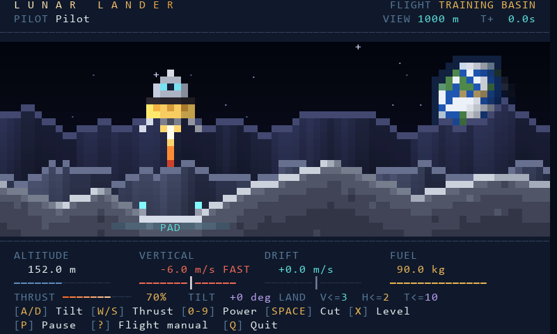

# Lunar Lander

A real-time, single-player lunar landing door game for NetBBS. Guide a fragile
lander between lunar ridges and settle it onto a lit pad on a dwindling tank:
fifteen ranked missions in three chapters, a daily challenge, medals for every
safe landing and a career from Cadet to Lunar Ace. Read the drift. Watch the
fuel. Make both feet count.

Lunar Lander is **one Python file** (`lunar_lander.py`) with no dependencies
beyond the standard library. It needs Python 3.11 or newer and a terminal of at
least 80×24: a flight simulator needs the room, so unlike the other bundled
games it does not go down to 40×12, and below 80×24 it pauses the flight and
asks for a bigger window. Pilot records are one SQLite file the door manages
itself.



## Where it runs

- **NetBBS:** bundled since NetBBS v7.41.0. NetBBS ships a tagged release of
  this file, so a NetBBS SysOp has nothing to install.
- **Other BBS software:** not supported. Lunar Lander speaks only NetBBS's
  native door API; it reads no DOOR32.SYS or DOOR.SYS, and it needs ANSI cursor
  addressing.
- **Standalone**, for trying it out: `python3 lunar_lander.py`. Local flights
  are practice; no records are kept.

## The game

- **Missions:** a training basin and fifteen ranked missions in three chapters
  (Maria, Highlands, Frontier), plus a daily challenge that changes at the
  node's local midnight.
- **Medals and ranks:** gold, silver and bronze for every safe landing, and a
  career from Cadet to Lunar Ace, with a medal ceremony and promotion fireworks.
- **Flight:** deterministic lunar physics; a landing needs both feet on the pad,
  a vertical speed of 3 m/s or less, a drift of 2 m/s or less and a tilt of 10°
  or less. Fuel alerts appear over the view at 30 and 10 seconds of hover fuel.
- **Presentation:** scenery in quadrant blocks, two pixels across each cell, with
  stars, a distant Earth and parallax ranges; a title splash with a rotating
  tagline; and skippable ignition, touchdown and crash scenes. Truecolor, 256-
  and 16-color terminals, with Unicode or ASCII glyphs. There is more scenery at
  132×50.
- **Records:** each pilot's best landing per mission, on per-mission
  leaderboards, for up to eight callers flying at once.

The [132×50 cockpit](docs/images/cockpit-132x50.png), the
[splash](docs/images/splash.gif), the [flight director](docs/images/menu-80x24.png),
the [medal ceremony](docs/images/medal.gif) and the [promotion](docs/images/promotion.gif)
are captured from the game's own renderer.

## Records

Records live in `pilots.db` in the directory named by `DOOR_LL_DATA_DIR`. A
bundled Lunar Lander keeps them in `<db>.doors/lunar_lander/`, next to
Voidrunner's saves and War Dialer's worlds, and NetBBS's backups include them.
If a profile points `DOOR_LL_DATA_DIR` elsewhere, the records there are not
backed up by NetBBS; back them up with SQLite's backup API, as
[OPERATIONS](docs/operations.md#records-backups-and-upgrades) describes.

Records are keyed by the node, the caller's numeric account and the mission, so
a handle rename keeps a pilot's records. Guests fly practice only. Flights are
not saved mid-air; a landing is committed before its debrief appears.

## SysOp setup

On NetBBS v7.41.0 or later, **Content ▸ Doors ▸ <kbd>G</kbd> Gallery** lists
Lunar Lander with the other bundled games. Registered from there, it gets a
900-second CPU allowance, which its continuously rendered flight needs for a
long session, instead of the usual 300.

To run a newer release than the bundled copy, register it by hand: download
`lunar_lander.py`, `netbbs.json`, `LICENSE` and `SHA256SUMS` from one tagged
release, verify the checksums and import `netbbs.json` through NetBBS's door
setup, adjusting its paths. Keep `cpu_seconds` at 900. The
[installation guide](docs/operations.md#native-netbbs-installation) covers each
step.

These settings go in the door profile's environment:

| Variable | Effect |
| --- | --- |
| `DOOR_LL_DATA_DIR` | Where `pilots.db` lives. Use an absolute, writable directory. |
| `DOOR_LL_PIXELS=half` | Draw with half blocks instead of quadrant blocks, for terminal fonts without quadrants (`▖▗▘▝`). |
| `DOOR_SPLASH=0` or `DOOR_LL_SPLASH=0` | Skip the title splash. `DOOR_SPLASH` is shared with the other native doors. |
| `DOOR_LL_SCENES=0` | Skip the ignition, touchdown and crash scenes. |
| `DOOR_LL_DATE_FORMAT` | How the daily challenge shows its date, for example `%d.%m.%Y`. The default is `%Y-%m-%d`. |

## NetBBS game events

Under NetBBS `door_api` 5 with game events switched on for this door
(`outbound.events` in `door_info.json`), Lunar Lander reports what ranked pilots
earn live. NetBBS's bot then announces it in chat and answers `!top` with the
career standings:

| Event | When |
| --- | --- |
| `rank` | A landing promotes the pilot to a new rank |
| `achievement` | A pilot's first gold medal on a mission ("Gold landing: Tranquility") |
| standings | The node's Career Roster by medal points, at launch and after a landing, when the order has changed |

Nothing earned offline or in an earlier session is reported. Without
`outbound.events` (standalone play, or events switched off), the door writes
nothing.

## Development

```sh
python -m pip install tzdata                    # Windows: named-timezone tests
python -m unittest discover -s tests -v         # the suite
python scripts/netbbs_smoke.py                  # the real NetBBS runtime; needs NetBBS installed
python scripts/capture.py --output .task/flight.png   # a frame as ANSI and PNG (needs Pillow)
```

A change to a screen comes with captures: the tests can prove that a screen
fits, never that it looks right. `scripts/capture.py` takes `--width`,
`--height`, `--color`, `--ascii`, `--pixels` and `--mode` (menu, help, a scene,
or `--gif` for an animation). The game's design is in
[docs/design.md](docs/design.md), and the acceptance evidence and remaining
field checks are in [docs/acceptance.md](docs/acceptance.md).

## Releases

Releases are tagged by hand once CI passes on the release commit.
`scripts/package_release.py`, run in a clean LF checkout, collects
`lunar_lander.py`, `netbbs.json`, `LICENSE`, `OPERATIONS.md` and `ACCEPTANCE.md`
with a `SHA256SUMS` file for the GitHub release. NetBBS vendors these releases.

Every release's notes carry a **NetBBS** line saying whether the saved data
changed, so a SysOp knows whether it can run ahead of the copy NetBBS bundles:
"saved data unchanged; runs on NetBBS 7.41.0 or later", or "changes the save
format; wait for the NetBBS release that bundles it". The format NetBBS's
backups check is the records database: application ID `0x4C4C0001`, schema
(`user_version`) 1, tables `pilots` and `scores`.

The banner is concept art rather than a game screen, and doubles as the
repository's social preview; the [artwork notes](assets/README.md) explain how
it was made and set.

## License

BSD 2-Clause, see [LICENSE](LICENSE).
